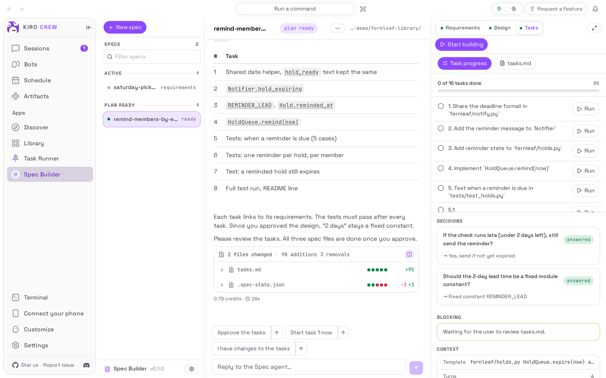
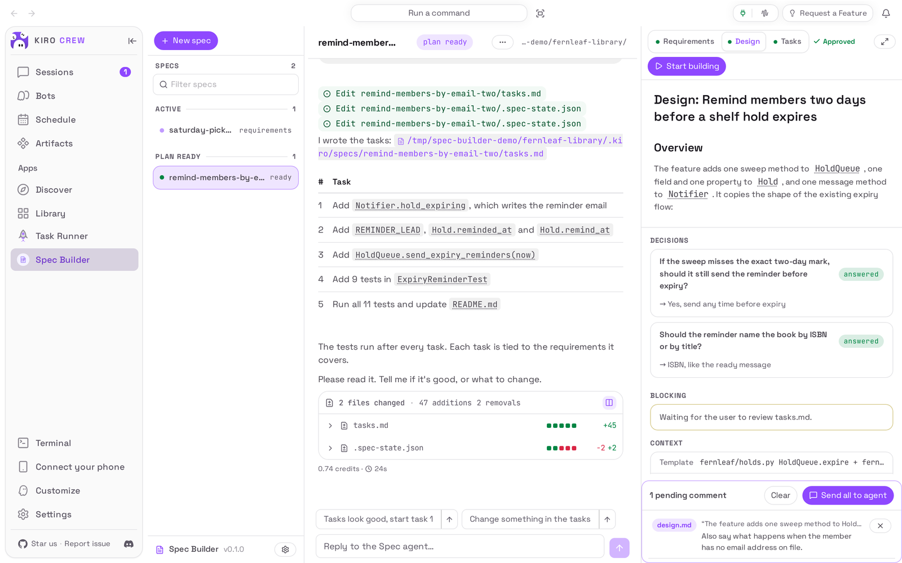

# Spec Builder

<picture>
  <source media="(prefers-color-scheme: dark)" srcset="docs/media/hero-dark.png">
  
</picture>

**Plan a change with an agent before it writes any code: requirements, design, then tasks.**

Spec Builder is an app for [Kiro Crew](https://github.com/kirodotdev/KiroCrew),
the open-source personal AI agent.

## What it is

Spec Builder adds a **Spec Builder** page to Kiro Crew. You describe a feature,
a bug or a small job and pick the project folder it is for; a spec agent reads
the project, asks you the questions that matter, and writes the plan in three
documents you review on the same page: **Requirements**, **Design** and
**Tasks**. Each one waits for your approval before the next is written, and
when the task list is right, **Start building** hands it to an agent that works
through it.

**Get started:** open **Apps → Library**, find **Spec Builder** under
**Disabled**, and choose **Enable** (see [Install](#install)).

## The problem it solves

Asking an agent to "just build it" works for small things. For anything bigger
the agent guesses what you meant, picks a design you would not have picked, and
you find out after it has changed a dozen files. Spec Builder slows the start
down on purpose: the agent has to write down what it will build and how, and
you get to read it, question it and correct it while it is still a document.
The plan is plain markdown in your project (`.kiro/specs/<name>/`), so it stays
with the code and also works with the Kiro IDE and CLI.

Spec Builder does not run anything on its own: nothing is built until you
choose **Start building** or run a single task.

## Top 3 use cases

### 1. Plan a new feature

You look after a small library's holds service and want members to get a
reminder before a book waiting for them goes back on the shelf. In **New spec**
you write that in a sentence, choose the project folder and keep **Build
something new**. The agent reads the code, writes `requirements.md` and puts
the questions it could not answer from the code under **Decisions**, each with
the option it recommends; one click answers one.


### 2. Track down a bug before fixing it

Members whose hold is ready on a Saturday are told the wrong last pickup day.
Choose **Fix a bug** instead: the agent's first document is an investigation
(the symptom, how to reproduce it, the root cause it found in the code) rather
than a feature description, and the design and tasks that follow are the fix.


### 3. Review a document like a pull request

Select any sentence in a document and choose **Comment** to attach a note to
it. Notes stack up in a tray under the document; **Send all to agent** sends
them as one message, and the agent revises the document. When it reads right,
the approve button above the document (**Approve → Design**, then **Approve →
Tasks**) moves the spec on.



## Watch it


[Watch the walkthrough as a video (MP4)](docs/media/walkthrough.mp4).

<sub>Recorded from a real Kiro Crew (`55439d8770`, the App Kit level-1 commit, with only the built-in copy removed) on a throwaway home, running this repository's own copy of the app on a made-up project, the Fernleaf Library holds service. The reminder spec was started through the app's page in the recording, and the stills above were taken on the same gateway right after it, so they show the same run; the bug spec was created through the app's own route on that gateway. The agent's messages, questions and documents came from a live model, so they will differ on every run, and its tool calls were allowed with the chat's own Trust button. The waits for the agent were shortened (by 118 seconds in all). The folder picker's first listing was pointed at the demo projects folder so no real home folder appears. Start building is shown but not run.</sub>

## Install

**Today: Spec Builder comes with Kiro Crew.** Nothing needs downloading. It
starts switched off:

1. In Kiro Crew, open **Apps → Library** in the left sidebar.
2. Scroll to the **Disabled** section, below the apps that are switched on.
3. On the **Spec Builder** tile, open the **⋯** menu and choose **Enable**.
4. **Spec Builder** now appears under **Apps** in the sidebar.

The copy that comes with Kiro Crew and this repository's copy, pictured here,
look and behave the same and keep your specs in the same places.

**Coming later: from the Kiro Crew App Store.** Once this app is listed there:

1. Open **Apps → Discover** in the left sidebar.
2. Search for **Spec Builder** and choose **Install**.
3. Kiro Crew asks **Trust “Spec Builder” to run its own code?** Spec Builder
   runs a small program of its own inside Kiro Crew to keep your list of specs
   and to start and stop the spec agent. Trusting it gives that program the
   same access Kiro Crew has (your files, your saved sign-ins and the
   internet), as the dialog says. If you are happy with that, choose **Trust
   this app**. You can take it back later in **Settings → Security →
   Third-party apps**.
4. The app installs switched off. Choose **Enable** on its page.

What you need: Kiro Crew on a Mac, Linux or Windows computer that can already
chat (if ordinary chats work, specs work), and a project folder on that
computer. **Work in a fresh worktree** needs the folder to be a git repository.

## First run

The page opens with **Plan your next feature with a spec** and a **Start your
first spec** button. Pick something you have been meaning to do in one of your
projects: the agent's first message is usually a few questions, so keep the
page open.


## How to use it

1. Choose **New spec**. Under **What do you want to do?** describe the change
   in a sentence or two; the line below it shows the name the spec will get.
2. Under **Which project is this for?** choose the folder: open folders in the
   list, or choose **Type a path instead**, then **Use this folder**. If the
   folder is a git repository you can tick **Work in a fresh worktree**: the
   agent then works on a new branch `spec/<name>` in its own folder next to the
   project, and your checkout is not touched.
3. Pick the kind of work: **Build something new** (requirements, design,
   tasks), **Fix a bug** (an investigation, then the fix), or **Quick plan**
   (just a goal and a task list). Choose **Start the conversation →**.
4. The agent reads the project. When it wants to run a command or write a
   file, the chat shows **Approval needed**: **Approve** allows that one call,
   **Trust** lets the agent go on without asking again for that kind of call
   in this spec's conversation, and **Reject** refuses it.
5. Read the document on the right. Answer the questions under **Decisions**
   with one click, type in the chat to ask for changes, or select text and
   choose **Comment** to leave notes, then **Send all to agent**.
6. When the document is right, choose the approve button above it
   (**Approve → Design**, then **Approve → Tasks**). The agent writes the next
   document.
7. With the task list done, choose **Start building** to hand the whole list to
   an agent that works through it, or **Run** next to one task to do just that
   one. **Pause** stops the build; the conversation and the documents stay.
8. The **⋯** menu next to a spec's name renames, duplicates, archives or
   deletes it. Deleting removes the spec from the list and ends its
   conversation; the markdown files stay in your project.

## Settings & data

- **Where your data lives:** each spec's documents are markdown files in your
  project, under `.kiro/specs/<name>/` (`requirements.md`, `design.md`,
  `tasks.md`, plus a `.spec-state.json` the page reads its decisions from).
  The gear button at the foot of the specs list opens **Settings**, where
  **Where should specs be saved?** can move new specs to one folder of your
  choice instead. The list of specs and those settings are in
  `~/.kiro/crew/workspace/spec-builder/`, the answers you recorded are in
  `~/.kiro/crew/apps/spec-builder/data/trust/spec-builder-decisions.json`
  (`~/.kiro/crew/trust/spec-builder-decisions.json` on a Kiro Crew below App Kit
  level 5; both under the folder you chose for Kiro Crew's data, if you moved it),
  and each spec's conversation is
  a chat session of its own, kept with your other sessions.
- **Model:** **Which model should run spec generation?** in **Settings** picks
  the model for spec agents; **Default (inherit)** uses the model your chats
  use.
- **What goes over the internet:** the spec agent uses the same AI model as the
  rest of your Kiro Crew and sees what it reads from your project. Spec Builder
  itself sends nothing anywhere.
- **What the agent can do:** the spec agent and the build agent have your main
  agent's tools, so they can read and change files in the project folder and
  run commands there, after the approvals described above. Spec Builder never
  approves a tool for you.
- **Turn it off:** **Apps → Library**, open the **⋯** menu on Spec Builder,
  choose **Disable**. Your specs, documents and conversations are kept.
- **Remove it** (once it is installed from the App Store): the same menu,
  **Uninstall**. Everything is kept: the documents in your projects, the
  conversations, the list of specs, the settings and the recorded answers.
  Even purging the app's data (`--purge-data`, under Development) deletes none
  of these, because none of them is in the app's own folder; delete the two
  paths above yourself if you want them gone. The copy that comes with Kiro Crew can be switched off but not
  removed.

## Troubleshooting / FAQ

**The agent has been "working" for a long time.**
Look in the chat for **Approval needed**: the agent is waiting for you to
**Approve**, **Trust** or **Reject** a tool call.

**The approve button is not there.**
It appears once the agent has written the current document, and only while it
is not working. If the agent asked a question instead, answer it first.

**"spec was deleted or recreated; reload and retry".**
The spec changed in another tab or window. Reload the page and try again.

**Start building or Pause answers "owner authorization required".**
Only the person who owns this Kiro Crew can start or stop a build.

**The Work in a fresh worktree box is not offered.**
The folder you chose is not a git repository. Pick a repository, or plan in the
folder directly.

**A deleted spec's files are still in my project.**
That is on purpose: the documents are your files. Delete the
`.kiro/specs/<name>/` folder yourself if you no longer want them.

## Development

This repository is the externally packaged form of the `spec-builder` app that
ships built into Kiro Crew. The two share a name, a version and the same
permissions, so a later Kiro Crew release can move an existing built-in install
onto this source in place, at a commit pinned in that release. Until a user's
Kiro Crew does that, it keeps running its built-in copy, and nothing here
changes what they run. [PORTING.md](PORTING.md) lists every place this copy
differs from the built-in and why, and what Kiro Crew still has to offer as a
public seam.

| Path | What it is |
|---|---|
| `app.json` | The app manifest, including the `ui` entry, the `backend.hooks.routes` entry and the `l10n` listing copy |
| `backend/routes.py` | `register_routes(ctx)`: the 21 route records the gateway serves under `/api/apps/spec-builder` |
| `backend/handlers.py`, `backend/orchestration/` | The route handlers: create, messages and decisions, approvals, tasks, build and stop, rename, archive, duplicate, delete |
| `backend/repository*.py`, `parsers.py`, `decisions.py`, `runtime.py` | The spec index, safe file access, git worktrees, the decision record, and the spec's chat session |
| `backend/_host.py` | The only module that touches the gateway (by name, through `importlib`) |
| `skills/spec-workflow/` | The skill that tells the spec agent how to work |
| `ui/src/` | The dashboard page (React), built against `@kirocrew/app-sdk` |
| `ui/i18n/` | The page's strings in every language the dashboard ships |
| `ui/dist/index.mjs` | The built page, **committed**: an install is a plain clone with no build step |
| `ui/tests/` | UI tests (vitest + jsdom), with light stand-ins for the host SDK |
| `assets/` | Store icon, hero art and screenshot (raster, as the catalog requires) |
| `tests/` | Backend and manifest tests, runnable offline with pytest |
| `capture/` | Captures the README media from a real, isolated Kiro Crew ([capture/README.md](capture/README.md)) |
| `docs/media/` | The README pictures and walkthrough, plus `media.json` (sizes, alt text, commits) |

### What it needs from Kiro Crew

Kiro Crew 0.13.0 or later (`minKiroCrewVersion`): App Kit level 1 structural
route records (a 0.12.x gateway skips them, so the app's API would answer 404
there) and `ctx.require_owner` (Start building and Pause), plus `ctx.scrub`
(redaction of everything shown that the agent or a project wrote), `ctx.audit`
(the security event log) and `ctx.data_dir`. A spec's agent is a dashboard chat
session the app drives through gateway functions no App Kit seam offers yet:
the chat runner and its session persistence, AutoNudge for the build, the
sandboxed process spawn for `git`, the critical tool-audit record, and the
no-follow file readers. `backend/_host.py` looks each up by name through
`importlib` and refuses the operation when one is missing; `register_routes`
reports what is missing through the app's health. No other backend module names
`kiro_crew` (`tests/test_no_host_imports.py`).

### Install from a clone

```bash
git clone https://github.com/KiroCrewCaptain/kirocrew-app-spec-builder
kirocrew app install ./kirocrew-app-spec-builder
```

On a Kiro Crew that still ships the built-in, the install is refused
(`app 'spec-builder' is already installed`). Elsewhere, turn it on from
**Apps → Library**: the app runs its own code (`backend.hooks` in `app.json`),
so **Enable** opens **Trust “Spec Builder” to run its own code?**, and **Trust
this app and enable** does both. `kirocrew app enable spec-builder` is refused
with `app_execution_denied` until the app is trusted.
`kirocrew app disable spec-builder` turns it off;
`kirocrew app uninstall spec-builder` removes the app. Neither touches the list
of specs or the settings: they live outside the app's own folder (see
[Settings & data](#settings--data)), so `--purge-data`, which deletes only that
folder's `data/`, deletes the recorded answers there and nothing else. To remove
the rest, delete `~/.kiro/crew/workspace/spec-builder/` (and, on a Kiro Crew below
App Kit level 5, `~/.kiro/crew/trust/spec-builder-decisions.json`) yourself, and the
`.kiro/specs/<name>/` folders in your projects if you want those gone too.

### Tests

```bash
python -m pip install -r tests/requirements.txt   # includes a pinned Kiro Crew
python -m pytest
cd ui && npm ci && npm run typecheck && npm test && npm run build
git diff --exit-code -- dist                      # the committed bundle is the build
```

No test starts a model or opens a socket beyond loopback.

### Re-capture the README media

The pictures and the recording come from a real, isolated Kiro Crew gateway
driven by [`capture/`](capture/README.md), on a Kiro Crew tree with the
built-in copy removed (capture/README.md says how). After any change to what
the app shows:

```bash
python capture/capture.py --kirocrew /path/to/KiroCrew
python capture/check_readme.py
```

Then look at every image and at a few frames of the video before committing
(see [CHECKLIST.md](CHECKLIST.md)).

## License

Apache License 2.0. See [LICENSE](LICENSE) and [NOTICE](NOTICE).
